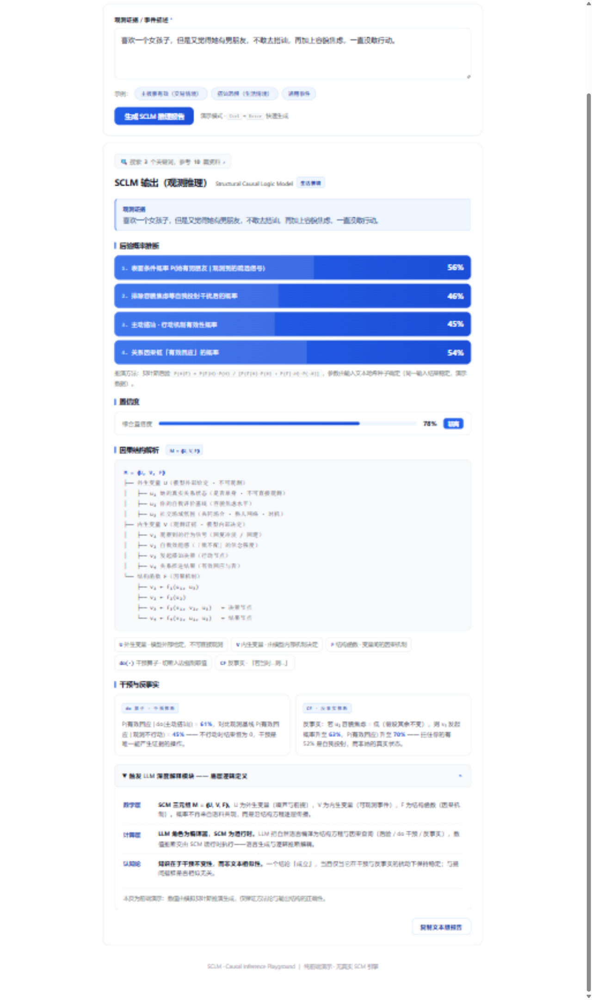

[English](README.md) | [简体中文](README.zh-CN.md)

# SCLM Causal Engine（SCLM 因果计算引擎）

**The LLM compiles, the code computes — every number in the report comes from a deterministic runtime, never from the model.**

[](LICENSE)
[](https://nodejs.org/)
[](server.js)



A local-first causal inference workbench. You give it an event in plain language; the LLM **compiles** it into quantitative structural causal models (SCMs) with structural equations; then a deterministic Monte Carlo runtime that lives in `server.js` does *all* the math — backdoor adjustment, do-interventions, counterfactuals, refutation tests. **The LLM is never allowed to output a result number.** That is the fundamental difference between this tool and "just asking GPT for a probability".

## Why this exists

- LLMs confidently invent numbers when asked about probabilities, effects, or outcomes. SCLM closes that door structurally: the model is a *compiler* (variable types, noise distributions, coefficients — domain judgment only), the runtime is the *calculator*.
- Correlation ≠ causation, quantified: the engine always shows the naive observational estimate next to the backdoor-adjusted causal effect, so confounding bias becomes a number you can see.
- Auditable output: the narrator LLM must cross-check every number it cites against the runtime's own list; on any mismatch it falls back to a template.

## Architecture

```
Compiler (LLM)
  compiles the event into 2-3 quantitative SCMs with structural equations:
  variable types / exogenous noise distributions / coefficients
  (the only exit for domain judgment) / sandbox agent prototypes
  forbidden to output any result numbers -> pure model spec only
        |
        v
Calculator (deterministic runtime in server.js)
  - Schema validation + Kahn cycle detection (failure -> repair loop, max 3 rounds)
  - Backdoor criterion: adjustment sets computed at runtime,
    descendants of X excluded to protect the total effect
  - do-intervention Monte Carlo: 1500 agents per arm -> ATE + bootstrap CI
  - naive observational estimate vs causal effect -> confounding bias, visualized
  - stratified backdoor adjustment to cross-check the identification result
  - DoWhy-style refutation tests: placebo / half-sample stability / noise robustness
        |
        v
Sandbox (multi-agent simulation)
  agents grouped by prototype (e.g. strong relay / institutional buyback /
  retail sentinel); per-prototype ATE and outcome distributions
  -- heterogeneous treatment effects at a glance
        |
        v
Narrator (LLM, number-verified)
  reads the results like a practitioner; every cited number is matched
  against the runtime's checklist; verification failure -> template fallback
        |
        v
Cross-model robustness + A/B/C grading (quantified)
```

## Three output formats (switch in the UI)

- **Engine** (default): the full three-layer computational report described above
- **Observational**: posterior probability bars + confidence + structure tree + do/counterfactual (direct LLM inference, lightweight)
- **Protocol**: a 6-layer closed-loop reasoning transcript (multi-hypothesis DAG + d-separation + repair loop)

One rule spans all formats: every simulation is labeled as simulation, with a standing degraded-mode notice — no deterministic language about the real world.

## Quick start

```bash
node server.js     # or: start.bat (Windows) / sh start.sh (macOS & Linux)
```

Open http://127.0.0.1:8641. The **Engine** format works with no API key at all — a built-in demo model runs through the same runtime and does the same real computation.

Requirements: Node.js ≥ 18. Zero third-party dependencies — no `npm install`, nothing to audit beyond two files.

## LLM configuration

In the page's "⚙ API 设置" panel: one-click platform presets (Zhipu GLM / DeepSeek / Kimi / OpenAI) fill in base URL and model; paste your raw API key → test connection → save. Or set environment variables:

```
LLM_BASE_URL   e.g. https://api.deepseek.com
LLM_API_KEY    your key
LLM_MODEL      e.g. deepseek-chat
```

Any OpenAI-compatible `/chat/completions` endpoint works.

## Privacy & security

- Your API key lives only in your browser's `localStorage`; it is forwarded by the local `server.js` per request — never persisted server-side, never seen by a third party.
- All computation runs on your machine.

## Support & commercial licensing

- Personal / research / open-source use: free under **AGPL-3.0** (see [LICENSE](LICENSE)).
- Closed-source commercial use, SaaS integration, or custom development: see [COMMERCIAL-LICENSE.md](COMMERCIAL-LICENSE.md).
- Sponsor the project: see [FUNDING.yml](FUNDING.yml) and the roadmap in [MONETIZATION.md](MONETIZATION.md).

## Files

- `index.html` — frontend (three output formats + orchestration view)
- `server.js` — orchestrator + SCM Monte Carlo runtime + LLM proxy (zero dependencies)
- `start.bat` / `start.sh` — one-click launch
