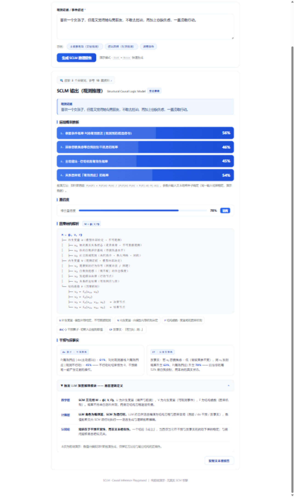

[English](README.md) | 简体中文

# SCLM 因果计算引擎（编译器 + 计算器 + 沙盘）

**LLM 负责编译，代码负责计算 —— 报告里的每一个数字都出自确定性运行时，无一来自大模型。**

[](LICENSE)
[](https://nodejs.org/)
[](server.js)



一个本地优先的因果推断工作台：把一段自然语言描述的事件交给 LLM，它将事件**编译**为带结构方程的定量结构因果模型（SCM），再由内置的确定性蒙特卡洛运行时完成全部数值计算——后门调整、do 干预、反事实、反驳检验。**LLM 全程无权生成任何结果数字**，这是它与"直接问 GPT 一个概率"的根本区别。

## 它解决什么问题

- 让 LLM 直接回答概率/效应问题，它会一本正经地编数字（幻觉）。SCLM 从结构上封死这条路：模型只是**编译器**（变量类型、噪声分布、系数——领域判断的唯一出口），计算由运行时完成。
- 相关≠因果，且被数值化：引擎总是把"观测天真估计"与"后门调整后的因果效应"并排呈现，混杂偏差变成一个看得见的数字。
- 输出可审计：转述员 LLM 引用的每个数字都要与运行时的清单逐一比对，核验失败自动回退模板转述。

## 三层架构

```
编译器（LLM）
  把事件编译为 2-3 个带结构方程的定量 SCM：
  变量类型 / 外生噪声分布 / 系数（领域判断的唯一出口）/ 沙盘智能体原型
  禁止输出任何结果数值 → 输出纯模型规格
        ↓
计算器（server.js 内确定性运行时）
  · Schema 校验 + Kahn 无环检测（失败→修正回路打回重编译，最多 3 轮）
  · 后门准则识别（运行时自行计算调整集，排除 X 的后代以保护总效应）
  · do 干预蒙特卡洛：每臂 1500 智能体 → ATE + bootstrap 置信区间
  · 观测天真对比 vs 因果效应 → 混杂偏差数值化（相关≠因果的直观呈现）
  · 后门调整估计（分层）验证识别结果
  · DoWhy 式反驳检验：安慰剂 / 半样本稳定 / 加噪稳健
        ↓
沙盘（多智能体推演）
  按智能体原型（如 强势接力/机构回补/散户哨兵）分组模拟，
  输出各原型 ATE 与结果分布——效应的异质性一目了然
        ↓
转述员（LLM，数字核验）
  老手口吻解读计算结果；引用的每个数字与运行时清单逐一比对，
  核验失败自动回退模板转述——LLM 全程无权生成数字
        ↓
跨模型稳健性 + A/B/C 定级（量化依据）
```

## 输出格式（三选一，页面切换）

- **计算引擎版**（默认）：上述三层架构的完整计算报告
- **观测推理版**：后验概率条 + 置信度 + 结构树 + do/反事实（LLM 直推，轻量）
- **协议推演版**：6 层闭环推演记录（多假设 DAG + d-分离 + 修正回路）

零号规则贯穿所有格式：运行时为模拟推演，常驻降级态标注，禁止确定性语气。

## 快速开始

```bash
node server.js      # 或双击 start.bat（Windows）/ sh start.sh（macOS、Linux）
```

打开 http://127.0.0.1:8641 。计算引擎版**无需 API Key** 即可体验：内置演示模型走同一套运行时，做的是真实计算。

要求：Node.js ≥ 18。**零第三方依赖**——无需 `npm install`，需要审计的只有两个文件。

## LLM 配置

页面「⚙ API 设置」：快捷平台按钮（智谱 GLM / DeepSeek / Kimi / OpenAI）一键填地址与模型，填原始 API Key → 测试连接 → 保存。也可用环境变量：

```
LLM_BASE_URL   例如 https://api.deepseek.com
LLM_API_KEY    你的 Key
LLM_MODEL      例如 deepseek-chat
```

任何兼容 OpenAI `/chat/completions` 格式的接口都可以。

## 隐私与安全

- API Key 仅存在你本机浏览器的 localStorage 中，经本机 `server.js` 逐请求转发——服务端不落盘，不经过任何第三方。
- 全部计算都在你自己的机器上完成。

## 赞助与商业授权

- 个人 / 研究 / 开源用途：以 **AGPL-3.0** 免费使用（见 [LICENSE](LICENSE)）。
- 闭源商业使用 / SaaS 集成 / 定制开发：见 [COMMERCIAL-LICENSE.md](COMMERCIAL-LICENSE.md)。
- 赞助项目：见 [FUNDING.yml](FUNDING.yml) 与变现路线图 [MONETIZATION.md](MONETIZATION.md)。

## 文件

- `index.html` — 前端（三种输出格式 + 编排展示）
- `server.js` — 编排器 + SCM 蒙特卡洛运行时 + LLM 转发（零依赖）
- `start.bat` / `start.sh` — 一键启动
